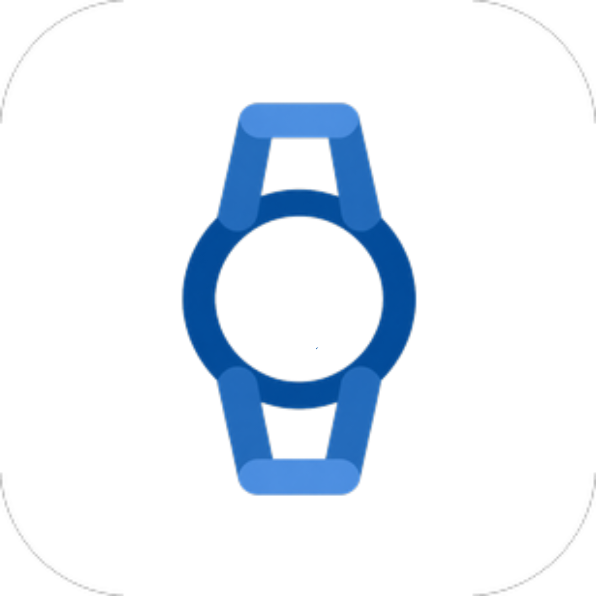
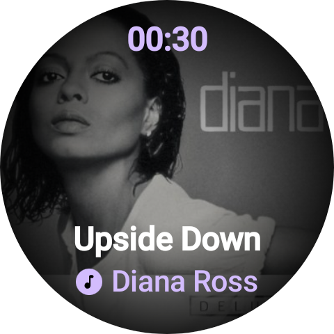
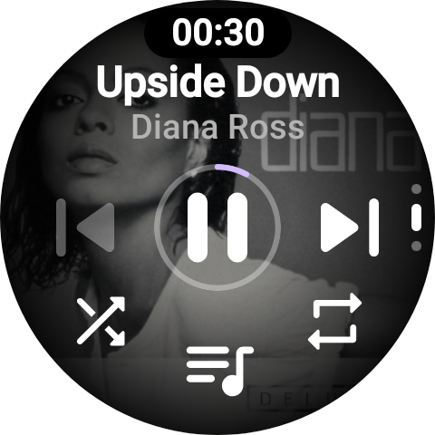
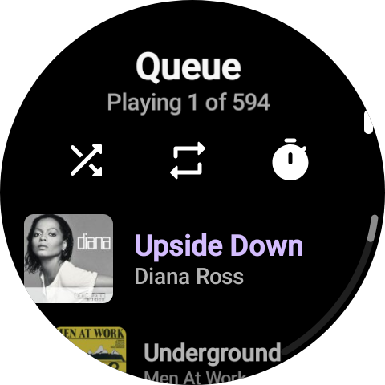
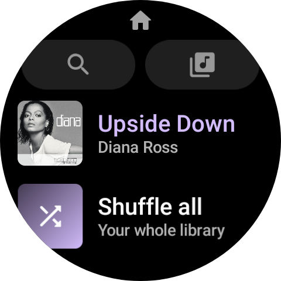
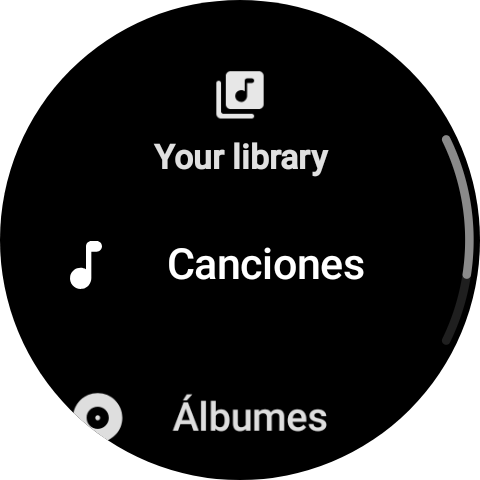

<p align="center">
  
</p>

<h1 align="center">Auxio Wear</h1>

<p align="center">
  A Wear OS remote for <a href="https://github.com/OxygenCobalt/Auxio">Auxio</a>, styled after Spotify's watch app.<br>
  Auxio itself is not modified.
</p>

<p align="center">
  
  
  
  
  
</p>

## Features

- **Now playing:** full-bleed cover, scrolling title, tap to pause.
- **Controls:** progress ring, skip, shuffle and repeat. The crown changes the phone's volume.
- **Library:** songs, albums, artists, genres and playlists, plus search and the play queue.
- **Media controls:** Auxio shows up in Wear OS's own media controls while it plays.
- **Your colors:** matches Auxio's accent, including Dynamic (Material You).
- **Sleep timer** for falling asleep to music.

## How it works

Auxio exposes its library and playback to other apps, the same way it does for Android Auto. A watch can't reach that directly, so a small **phone app** talks to Auxio and relays everything to the **watch app** over Wear OS's Data Layer.

```
watch app  <-->  phone app  <-->  Auxio
```

## Install

You need Auxio on an Android phone and a paired Wear OS 3+ watch.

1. Open the **Actions** tab, pick the latest successful run and download both artifacts.
2. Install **Auxio_Companion_Phone** on the phone and **Auxio_Companion_Wear** on the watch. Take both from the same run, they must share a signing key.
3. Open Auxio once, then open **Auxio Companion** on the phone, then **Auxio** on the watch. Allow notifications when asked.
4. In the phone app, pick the same accent color you use in Auxio.

To build it yourself, open this folder in Android Studio, or run `./gradlew :phone:assembleDebug :wear:assembleDebug`.

## Good to know

- Auxio keeps its theme private, so the accent color is chosen once in the phone app.
- Auxio takes over the watch's media controls once you've opened the watch app, and stays there while music plays. If the phone app has been stopped by Android, open the watch app again.
- Auxio has no play history to share, so Home shows your playlists (or albums) rather than "recently played".

## Project layout

| Folder | What it is |
| --- | --- |
| `phone/` | Phone app: connects to Auxio and relays to the watch |
| `wear/` | Watch app: the Compose UI and the media session |
| `protocol/` | Messages shared by both |

## Credits

- **[Max904yt](https://github.com/Max904)**: idea, design direction, testing and feedback
- **Claude** (by [Anthropic](https://www.anthropic.com)): code, written together with Max904yt
- **[Auxio](https://github.com/OxygenCobalt/Auxio)** by OxygenCobalt, the music player this controls

## License

GPL-3.0, like Auxio. See [LICENSE](LICENSE).
Not affiliated with Auxio or Spotify. The design is inspired by Spotify's Wear OS app.
